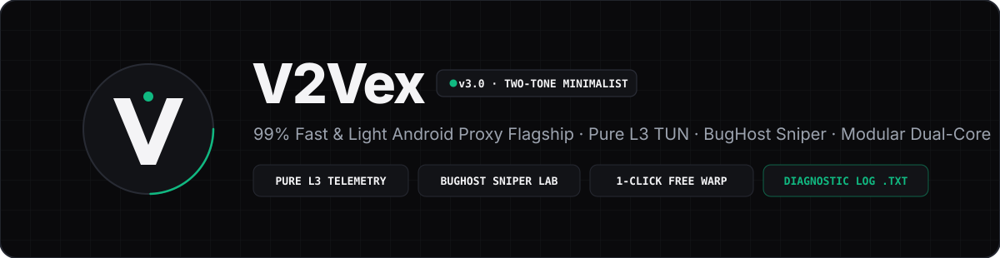

<div align="center">



<br/>

[](https://github.com/iganramdani/V2Vex/releases/latest)
[](https://github.com/iganramdani/V2Vex/actions)
[-10B981?style=for-the-badge&logo=android&logoColor=white&labelColor=121317)](https://github.com/iganramdani/V2Vex/releases/latest)
[](#-whats-new-in-v330)
[](#-credits--open-source-respect)

<br/>

### ⚪⚫ Two-Tone Minimalist UX · 🛡️ Pure L3 TUN · ⚡ Dual-Core (Xray + Sing-box) · 🧪 BugHost Sniper · 🪵 Strict-Privacy `.txt` Log

[**⬇️ Download v3.3.0 APK**](https://github.com/iganramdani/V2Vex/releases/latest) •
[**🔥 What's New in v3.3.0**](#-whats-new-in-v330) •
[**🎯 Real-Device Calibration**](#-real-device-forensic-calibration) •
[**⚔️ vs Competitors**](#%EF%B8%8F-vs-competitors) •
[**🙏 Credits & Respect**](#-credits--open-source-respect) •
[**🛠️ Build**](#%EF%B8%8F-build--automation)

</div>

---

## 🚀 Download Ready-to-Install v3.3.0 APK

> [!IMPORTANT]
> **V2Vex v3.3.0** ships **ABI-split APKs** (`arm64-v8a`, `armeabi-v7a`, and `universal`) with pinned & SHA-256 verified **`XTLS/Xray-core`**, **`SagerNet/sing-box`**, native C **`hev-socks5-tunnel`**, and **`geoip.dat` & `geosite.dat`** — engineered for Pure L3 TUN telemetry, fast cached DoH DNS, and near-zero screen-off SystemUI wakeups.

<div align="center">

[-10B981?style=for-the-badge&logo=android&logoColor=032217)](https://github.com/iganramdani/V2Vex/releases/latest)

</div>

---

## 🔥 What's New in v3.3.0

| Pillar | v3.3.0 Engineering |
| :--- | :--- |
| 🛡️ **Hardened TLS & Privacy Security** | Never silently downgrades TLS verification (`insecure: true`) on Sing-box fallback when Safe SNI Spoofing (`verifyPeerCertByName`) is active; **Strict Privacy Redaction** (default ON) masks server addresses, SNI, hosts, and paths in `logV2Vex.txt`; optional **SOCKS5/HTTP username+password auth** when `Allow LAN` is enabled; 30-min auto-reset + Home pill for `debug` logs. |
| ⚡ **True Auto Dual-Core Health Failover** | Post-connect HTTP 204 health probe + mutex-guarded runtime crash failover between **Xray-core** and **Sing-box**; Sing-box Multi-Hop Chain (`detour`) support; honest `Xray-only` badges when Sing-box is active; in-memory binary probe cache eliminates redundant Go process spawns. |
| 📦 **ABI-Split APKs & Reproducible Builds** | Separate `arm64-v8a`, `armeabi-v7a`, and `universal` APKs + `SHA256SUMS.txt` cut download size cleanly; pinned core versions & SHA-256 checksums in [`scripts/core-versions.env`](scripts/core-versions.env). |
| 🎛️ **Settings, Routing & MIUI Polish** | Local editable state + inline validation + Apply for Port, MTU, DNS, and Fragment inputs (zero keystroke snapping or hot-reload churn); real installed-vs-latest version comparison in `Check Core`; MIUI Powerkeeper + Autostart deep-links & banner restore; GeoSite/GeoIP tag validation warnings & stable `packId` Quick Packs; SpeedLab metered network data warning. |
| 📊 **Pure L3 TUN Speed Meter** | Eliminates Android eBPF `127.0.0.1` loopback inflation by reading directly from native `TProxyGetStats()` (`hev-socks5-tunnel` TUN read/write counters) + `SpeedLabTrafficCounter`, paired with `PowerManager.isInteractive` screen-off power saving. |
| 🧪 **BugHost / CDN Sniper & 1-Click WARP** | Concurrent TLS SNI + HTTP HEAD scanner + Xray `verifyPeerCertByName` Safe SNI Spoofing, plus built-in pure-Kotlin RFC 7748 Curve25519 Cloudflare WARP generator ready for direct or Multi-Hop Chain (`Bug Node → WARP Clean IP`). |

---

## 🔬 Real-Device Forensic Calibration

V2Vex was forensically audited on real Android hardware (**Xiaomi Redmi Note 9 `M2003J15SC` · Helio G85 · Android 12 · IPv6/NAT64 Mobile Carrier**):

<details open>
<summary><b>🔍 Real-World Telemetry & Fixes (Click to inspect)</b></summary>

<br/>

1. **Solved Loopback UID Counter Inflation**: On Android 12+ eBPF, `TrafficStats.getUidTxBytes()` counts Xray writing downloaded data over `127.0.0.1` to `hev-socks5-tunnel` as "Upload". V2Vex reads pure L3 `tun0` counters directly from `TProxyGetStats()` (verified against `heiher/hev-socks5-tunnel` `src/hev-jni.c` & `hev-socks5-tunnel.c`: `stats[1]` = TUN read / upload, `stats[3]` = TUN write / download).
2. **Solved Raw UDP DNS Delay**: Added `protocol: "dns"` (`dns-out`) + top-priority port-53 hijack so DNS queries use encrypted DoH multiplexing + RAM cache instead of opening new UDP-over-HTTPUpgrade streams.
3. **Solved QUIC-over-HTTPUpgrade Pipe Storms**: Enabled 1-tap `QUIC 443 BLOCK` so YouTube/Instagram/Chrome immediately negotiate fast HTTP/2 over TCP instead of tunneling lossy UDP:443 over TCP transports.
4. **Solved Carrier NAT64 (`64:ff9b::/96`) & SNI-Spoof `x509` Errors**: Added `UseIPv4` outbound dial strategy + `verifyPeerCertByName` certificate pinning (with strict anti-downgrade guard on Dual-Core fallback).

</details>

---

## ⚔️ vs Competitors

| Capability | ⚪ **V2Vex v3.3.0** | v2rayNG | NekoBox | HTTP Custom | Hiddify |
| :--- | :---: | :---: | :---: | :---: | :---: |
| **UX Design** | **Two-Tone Minimalist (Compose M3)** | Legacy XML | Legacy XML | Ad-heavy XML | Heavy Flutter |
| **Pure L3 Speed Meter + Screen-Off Saver** | ✅ Verified `TProxyGetStats` | ⚠️ Basic | ⚠️ Basic | ❌ Basic | ⚠️ High RAM |
| **Strict-Privacy `.txt` Diagnostic Export** | ✅ Save & Share `logV2Vex.txt` | ❌ Raw text | ❌ Raw text | ❌ Minimal | ⚠️ Heavy |
| **Safe SNI Spoofing (`verifyPeerCertByName`)** | ✅ 1-Tap UI Pinning | ⚠️ Manual | ❌ Rare | ❌ Forces Insecure | ❌ No |
| **Built-in BugHost / CDN Sniper Studio** | ✅ Concurrent TLS/CDN Scanner | ❌ No | ❌ No | ⚠️ Separate tool | ❌ No |
| **1-Click Free Cloudflare WARP + Chain** | ✅ Zero-Dep X25519 | ❌ No | ❌ Manual | ❌ No | ✅ Built-in |
| **Multi-Stream SpeedLab v2 (True RTT)** | ✅ Keep-Alive + Metered Guard | ❌ Ping only | ❌ URL test | ❌ No | ❌ Ping only |

---

## 🙏 Credits & Open-Source Respect

**V2Vex** stands on the shoulders of giants. Full respect and gratitude to the open-source authors whose work makes V2Vex possible (see [CREDITS.md](CREDITS.md) and **Settings → Open-Source Credits & Respect** inside the app):

- 🛡️ **[@RPRX](https://github.com/RPRX) & Project X Contributors** — [**XTLS/Xray-core**](https://github.com/XTLS/Xray-core) (`MPL-2.0`): For engineering VLESS, XTLS-Vision, REALITY, XHTTP, and the core proxy runtime.
- ⚡ **Wanli He ([@heiher](https://github.com/heiher))** — [**heiher/hev-socks5-tunnel**](https://github.com/heiher/hev-socks5-tunnel) (`MIT`): For the ultra-fast, tiny native C L3 TUN-to-SOCKS5 engine (`libhev-socks5-tunnel.so`).
- 📦 **nekohasekai ([@nekohasekai](https://github.com/nekohasekai))** — [**SagerNet/sing-box**](https://github.com/SagerNet/sing-box) (`GPL-3.0`): For pioneering universal proxy schemas & Modular Dual-Core Hysteria2/TUIC interoperability.
- 🌍 **[@Loyalsoldier](https://github.com/Loyalsoldier)** — [**Loyalsoldier/v2ray-rules-dat**](https://github.com/Loyalsoldier/v2ray-rules-dat) (`GPL-3.0`): For maintaining high-precision `geoip.dat` & `geosite.dat` routing rules.
- 🧭 **[@2dust](https://github.com/2dust)** ([v2rayNG](https://github.com/2dust/v2rayNG)) & **[@MatsuriDayo](https://github.com/MatsuriDayo)** ([NekoBoxForAndroid](https://github.com/MatsuriDayo/NekoBoxForAndroid)): For pioneering Android V2Ray/Xray URI standards and community conventions.
- 🔐 **Jason A. Donenfeld** ([WireGuard](https://www.wireguard.com/)), **Daniel J. Bernstein** (X25519), **Cloudflare**, **JetBrains**, and **AOSP**.

---

## 🛠️ Build & Automation

<details>
<summary><b>🧑‍💻 Local Build, Pinned Cores, Unit Tests & Tasker Automation Intents</b></summary>

<br/>

```bash
# 1. Fetch pinned & SHA-256 verified Xray-core, Sing-box, hev-socks5-tunnel & GeoData
#    (Versions pinned in scripts/core-versions.env; pass --latest to check upstream latest)
chmod +x scripts/update-core.sh
./scripts/update-core.sh

# 2. Run unit tests & build ABI-split release APKs (arm64-v8a, armeabi-v7a, universal)
gradle testDebugUnitTest assembleRelease --no-daemon
```

### 🤖 Tasker / MacroDroid / ADB Broadcast Intents
```bash
adb shell am broadcast -a com.v2vex.client.AUTOMATION_CONNECT -n com.v2vex.client/.service.AutomationReceiver
adb shell am broadcast -a com.v2vex.client.AUTOMATION_DISCONNECT -n com.v2vex.client/.service.AutomationReceiver
adb shell am broadcast -a com.v2vex.client.AUTOMATION_TOGGLE -n com.v2vex.client/.service.AutomationReceiver
```

</details>

---

<div align="center">

**Engineered with precision · Minimalist by conviction · Respectful to Open Source.**

</div>
