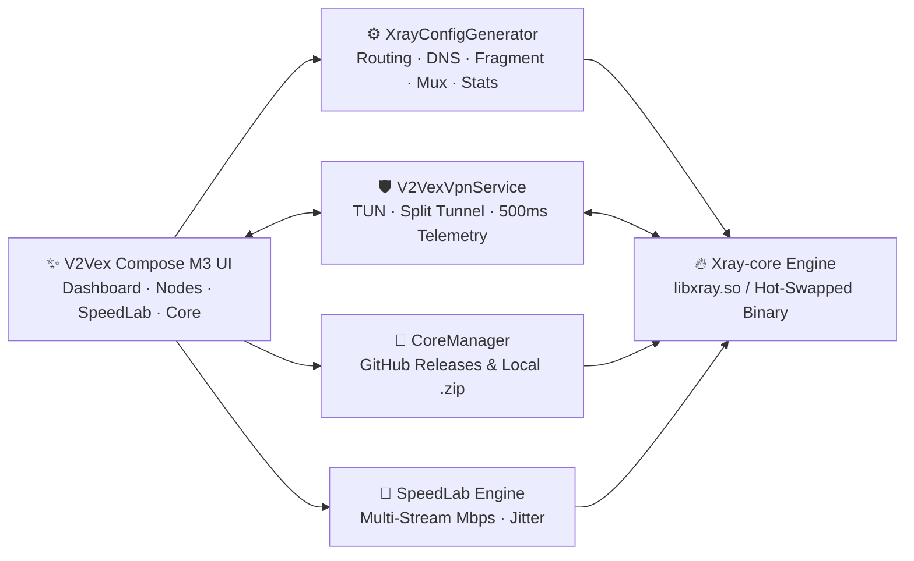

<div align="center">


<br/>

[](https://github.com/iganramdani/V2Vex/releases/latest)
[](https://github.com/iganramdani/V2Vex/actions)
[-3DDC84?style=for-the-badge&logo=android&logoColor=white&labelColor=0F1624)](https://github.com/iganramdani/V2Vex/releases/latest)
[](#-architecture)
[](#-philosophy-99-fast--light)

<br/>

### ⚡ Ultra-Lightweight · 🔄 Hot-Swappable Xray-core · 🎯 Precision Mbps SpeedLab · 🎛️ Power-User Flexibility

[**⬇️ Download Latest APK**](https://github.com/iganramdani/V2Vex/releases/latest) •
[**⚡ Features**](#-why-v2vex) •
[**🎯 SpeedLab**](#-speedlab--high-accuracy-mbps-engine) •
[**🔄 Core Updater**](#-effortless-core-updates) •
[**⚔️ Comparison**](#-vs-competitors) •
[**🏗️ Architecture**](#%EF%B8%8F-architecture) •
[**🛠️ Build**](#%EF%B8%8F-build--contribute)

</div>

---

## 🚀 Download Ready-to-Install APK

> [!TIP]
> Every official GitHub Release APK comes **signed**, **aligned**, and **pre-bundled with the latest official `XTLS/Xray-core` + `geoip.dat` & `geosite.dat`** — ready to connect immediately on first tap!

<div align="center">

[-00E676?style=for-the-badge&logo=android&logoColor=001F0F)](https://github.com/iganramdani/V2Vex/releases/latest)

</div>

---

## 💡 Philosophy: "99% Fast & Light"

Most proxy clients accumulate megabytes of legacy XML layouts, reflection DI frameworks, tracking SDKs, and sluggish UI threads. **V2Vex** is engineered from scratch to feel instantaneous:

| Pillar | What V2Vex Does Differently |
| :--- | :--- |
| ⚡ **Zero-Bloat Engine** | Pure Kotlin + Coroutines + Jetpack Compose M3 + compile-time `kotlinx.serialization`. **No Hilt/Dagger, no OkHttp/Retrofit, no analytics.** R8-shrunk app engine is just **~1.3 MB**. |
| 🔄 **1-Tap Core Hot-Swap** | Update `XTLS/Xray-core`, `geoip.dat`, and `geosite.dat` straight from GitHub Releases inside the app — or import any custom `.zip` / `xray` binary offline! |
| 🎯 **True Mbps Accuracy** | Built-in **SpeedLab** uses monotonic nanosecond timing, multi-stream saturation (`1x`/`4x`/`8x`), warm-up discard, trimmed-mean filtering, and RFC 3550 jitter. |
| 🎛️ **Extreme Flexibility** | Full protocol & transport control, TLS Fragmentation (DPI Bypass), Mux.Cool, Sniffing, DoH/DoT/FakeDNS, Custom Routing Rules, Per-App Split Tunneling, and Raw Xray JSON editing. |
| ✨ **Interactive Cyber UI** | 60fps Canvas Arc Speedometer, animated spring Connection Orb, touch-scrubbable real-time Mbps area chart, Quick Settings Tile, and Cyber Dark / AMOLED / Light themes. |

---

## ✨ Why V2Vex?

<details open>
<summary><b>🌐 Supported Protocols & Transports (Click to toggle)</b></summary>

<br/>

| Protocol | Highlights | Supported Transports | Security |
| :--- | :--- | :--- | :--- |
| 🔥 **VLESS** | `XTLS-Vision`, `REALITY` (`pbk`, `sid`, `spx`), uTLS fingerprint | `TCP`, `WS`, `gRPC`, `HTTPUpgrade`, `XHTTP/SplitHTTP`, `H2`, `mKCP` | `REALITY`, `TLS`, `None` |
| 🛡️ **VMess** | v2rayN Base64 JSON import/export, `auto` / `aes-128-gcm` / `chacha20` | `TCP`, `WS`, `gRPC`, `HTTPUpgrade`, `XHTTP`, `H2`, `mKCP` | `TLS`, `None` |
| 🐎 **Trojan** | Full password auth, `multi` / `gun` gRPC, REALITY support | `TCP`, `WS`, `gRPC`, `HTTPUpgrade`, `XHTTP` | `TLS`, `REALITY` |
| 🕶️ **Shadowsocks** | SIP002 & Legacy Base64, AEAD & SS2022 ciphers | `TCP` | `None` |
| 🧦 **SOCKS5 / HTTP** | Optional username/password auth | `TCP` | `None` |
| 🐉 **WireGuard** | Native Xray WireGuard outbound (`secretKey`, `reserved`, custom MTU) | `UDP` | Native Noise |
| 🧩 **Raw Xray JSON** | Full custom Xray-core JSON editor with live syntax validation & preview | Any Xray transport | Any |

</details>

<details>
<summary><b>🎛️ Power-User Controls & Engine Tweaks (Click to expand)</b></summary>

<br/>

- 🔓 **DPI Bypass (TLS Fragmentation)** — Split `tlshello` / `1-3` packets with configurable byte length (`10-20`) and interval (`10-20ms`) directly from Dashboard or Settings.
- 🔀 **Mux.Cool Multiplexing** — Configurable `concurrency` & `xudpConcurrency` (automatically skipped when `xtls-rprx-vision` flow is active, per Xray spec).
- 👃 **Traffic Sniffing** — Granular toggles for `http`, `tls`, `quic`, `fakedns`, and `routeOnly`.
- 🧭 **Custom Routing Rule Builder** — Instant presets (`Global`, `Bypass LAN`, `AdBlock + Bypass LAN`, `Custom`) + custom rules matching **Domain/Geosite**, **IP/CIDR/GeoIP**, **Port**, or **Protocol** → `Proxy` / `Direct` / `Block`.
- 🌍 **DNS Engine** — Primary DoH/DoT/UDP, backup DNS, direct LAN DNS, `queryStrategy`, and **FakeDNS** toggle.
- 📱 **Per-App Split Tunneling** — Proxy all apps, bypass selected apps, or proxy-only selected apps with a searchable installed-app picker.
- 📡 **Subscriptions & Auto-Fastest** — Multi-subscription manager with `subscription-userinfo` traffic/quota parsing, concurrent batch RTT testing, and 1-tap **Auto Fastest** node selector.
- 🧰 **Quality of Life** — Android Quick Settings Tile, deep links (`vless://`, `vmess://`, `trojan://`, `ss://`, `v2vex://`), live filterable Xray Log Console, and 1-tap Full JSON Backup/Restore.

</details>

---

## 🎯 SpeedLab — High-Accuracy Mbps Engine

Standard proxy speed tests often misreport throughput because they use a single stream, include TLS/DNS handshake latency, or suffer from burst spikes. **V2Vex SpeedLab** fixes all three:

<details open>
<summary><b>🔬 How V2Vex Achieves Lab-Grade Mbps Precision</b></summary>

<br/>

1. ⏱️ **Monotonic Nanosecond Clock**: Uses `System.nanoTime()` so measurements are completely immune to wall-clock adjustments.
2. 🌊 **Multi-Stream Saturation**: Runs `1x`, `4x`, or `8x` parallel HTTP/HTTPS streams through the active tunnel (or direct network) to fill high-BDP fiber/5G links.
3. 🔥 **Warm-Up Discard**: Discards the initial ramp-up window (`1.5s`) so TCP slow-start and TLS handshakes never drag down your real speed.
4. 📊 **Trimmed-Mean Steady State**: Samples throughput every `150ms`, trims bottom 10% and top 5% outliers, and reports **Sustained Mbps**, **Peak Mbps**, and **Stability %**.
5. 📶 **RFC 3550 Jitter**: Computes mean consecutive RTT delta across 5 probes (`Ping ms` + `Jitter ms`).

</details>

---

## 🔄 Effortless Core Updates

Keep your Xray-core bleeding-edge in seconds — **zero waiting for app store updates**:

<details>
<summary><b>📲 Option A: In-App 1-Tap Core & GeoData Manager</b></summary>

<br/>

1. Open **V2Vex** → **Core** tab.
2. Tap **Update Core** to fetch the latest `XTLS/Xray-core` release matching your device ABI.
3. Tap **Update Geo** to refresh `geoip.dat` & `geosite.dat` from `Loyalsoldier/v2ray-rules-dat`.
4. Or tap **Import Custom Xray .zip / Binary** to test nightly/custom Xray builds offline!

</details>

<details>
<summary><b>💻 Option B: 1-Command Build-Time Core Bundler</b></summary>

<br/>

```bash
chmod +x scripts/update-core.sh
./scripts/update-core.sh
```

Automatically fetches the latest official `XTLS/Xray-core` Android binaries into `app/src/main/jniLibs/<abi>/libxray.so` (Android 10–15 W^X compliant) and GeoData into `app/src/main/assets/`.

</details>

---

## ⚔️ vs Competitors

| Capability | ⚡ **V2Vex** | v2rayNG | NekoBox / SagerNet | Hiddify |
| :--- | :---: | :---: | :---: | :---: |
| **App Engine Footprint (R8)** | **~1.3 MB** 🏆 | ~12+ MB | ~25+ MB | ~35+ MB |
| **1-Tap Core & Geo Updater** | ✅ Built-in + Local `.zip` | ⚠️ Geo only | ⚠️ Geo only | ❌ Bundled only |
| **Multi-Stream Mbps SpeedLab** | ✅ Gauge + Jitter + Trimmed Mean | ❌ Ping only | ⚠️ Basic URL test | ❌ Ping only |
| **Interactive Live Mbps Chart** | ✅ Drag-to-Inspect | ❌ Text only | ❌ Text only | ⚠️ Basic |
| **TLS Fragmentation (DPI Bypass)** | ✅ 1-Tap Dashboard Toggle | ⚠️ Deep menu | ⚠️ JSON/Manual | ✅ Built-in |
| **VLESS REALITY + XHTTP/SplitHTTP** | ✅ Native UI + JSON Preview | ✅ Yes | ✅ Yes | ✅ Yes |
| **Zero-Bloat Compose Material 3** | ✅ 100% Pure Compose | ❌ Legacy Views | ❌ Legacy Views | ⚠️ Flutter Engine |

---

## 🏗️ Architecture



---

## 🛠️ Build & Contribute

<details>
<summary><b>🧑‍💻 Local Build, Unit Tests & CI Release Commands</b></summary>

<br/>

```bash
# 1. Clone V2Vex
git clone https://github.com/iganramdani/V2Vex.git
cd V2Vex

# 2. Bundle latest official Xray-core & GeoData
./scripts/update-core.sh

# 3. Run all JVM unit tests (URI Parser, Config Generator, SpeedMath)
gradle testDebugUnitTest

# 4. Build Debug / Release APK
gradle assembleDebug
gradle assembleRelease
```

🚀 **Automated GitHub Releases**: Pushing any `v*` tag (e.g., `git tag v1.0.1 && git push origin v1.0.1`) automatically triggers [GitHub Actions](.github/workflows/build-release.yml) to bundle the latest Xray-core, run all unit tests, align & sign the APK, and publish a new GitHub Release!

</details>

---

<div align="center">

**Built with ⚡ for speed, precision, and freedom.**

If **V2Vex** helps you stay fast & light, drop a ⭐ on the repo!

</div>
